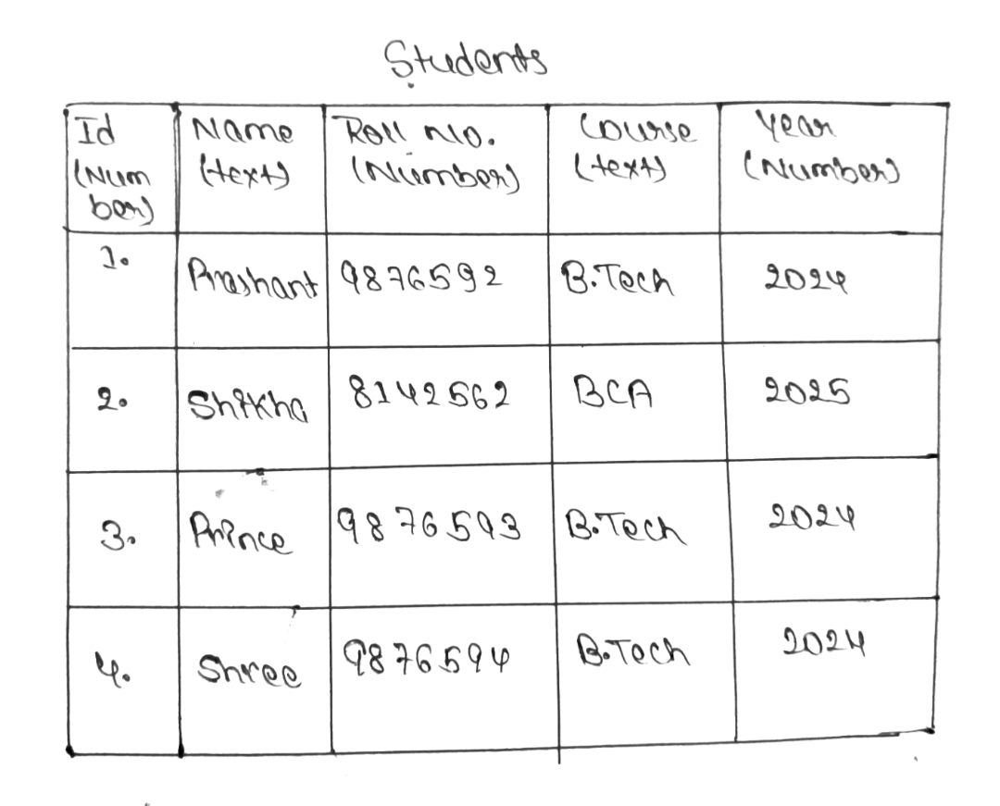

# Day 2: Tables, Rows, Columns & psql Meta-commands

**Date:** 26 Oct 2026
**Environment:** PostgreSQL / psql 18.6 on Windows (SQL Shell), server `localhost`, port `5433`
**Task:** Create a practice database, list it with `\l`, draw a `students` table on paper.

---

## 1. Core Concepts

| Excel analogy | PostgreSQL term | Meaning |
|---|---|---|
| Whole file | **Database** | Container for all tables |
| Sheet | **Table** | A collection of related records (e.g. `students`) |
| Header | **Column** | One attribute with a fixed data type (e.g. `name TEXT`) |
| One line of data | **Row** | One record (e.g. one student) |
| Single box | **Cell** | Intersection of a row and a column (one value) |

```
Database: practice_db
   └── Table: students
         id | name
        ----+------
```

**Key difference from Excel:** every column has a fixed data type, so the database rejects invalid data (e.g. `"twenty"` in an integer `age` column).

---

## 2. SQL Commands vs psql Meta-commands

| Type | Example | Needs `;`? | Handled by |
|---|---|---|---|
| SQL command | `CREATE DATABASE practice_db;` | Yes | PostgreSQL server |
| Meta-command | `\l`, `\c`, `\dt`, `\d` | No | `psql` client itself |

Meta-commands only work inside `psql`. They will not work in pgAdmin or Python.

### Meta-commands learned

| Command | What it does | Example |
|---|---|---|
| `\l` | List all databases | `\l` |
| `\c dbname` | Connect to a database | `\c practice_db` |
| `\dt` | List tables in the current database | `\dt` |
| `\d tablename` | Show table structure (columns, types, nullable, default) | `\d students` |
| `\set ECHO_HIDDEN on/off` | Show the real SQL behind a meta-command | `\set ECHO_HIDDEN on` |

### Common mistakes
- Writing `\l;` (meta-commands take no semicolon).
- Forgetting `;` on SQL, so the prompt changes to `postgres-#` and waits for more input.
- Running `\dt` in the wrong database and thinking tables vanished.

---

## 3. What I Actually Ran

```sql
-- Step 1: create the database (SQL, needs ;)
postgres=# CREATE DATABASE practice_db;
CREATE DATABASE

-- Step 2: list databases
postgres=# \l
```
Result: 4 databases listed: `postgres`, `practice_db`, `template0`, `template1`.

```sql
-- Step 3: connect to the new database
postgres=# \c practice_db
You are now connected to database "practice_db" as user "postgres".

-- Step 4: check tables (new database, so empty)
practice_db=# \dt
Did not find any tables.

-- Step 5: peek under the hood
practice_db=# \set ECHO_HIDDEN on
practice_db=# \l
```
`\l` internally runs a `SELECT` on the system catalog `pg_catalog.pg_database`. Meta-commands are just SQL queries underneath.

```sql
-- Step 6: bonus, create a first table
practice_db=# \set ECHO_HIDDEN off
practice_db=# CREATE TABLE students (id INT, name TEXT);
CREATE TABLE

practice_db=# \dt
 Schema |   Name   | Type  |  Owner
--------+----------+-------+----------
 public | students | table | postgres

practice_db=# \d students
 Column |  Type   | Collation | Nullable | Default
--------+---------+-----------+----------+---------
 id     | integer |           |          |
 name   | text    |           |          |
```

### Things I noticed
- `\dt` on an empty database prints **"Did not find any tables."** (this is not an error, there are just no tables yet).
- `INT` is shown as `integer` in `\d`. PostgreSQL stores the canonical type name.
- Tables are created in the `public` schema by default.
- `Nullable` is blank, which means NULLs are allowed. No constraints exist yet (Day 3+).
- This server runs on port **5433**, not the default 5432.

---

## 4. Paper Diagram: `students` table

>Photo of the hand-drawn table `

Requirements I followed: at least 5 columns, at least 3 sample rows, data type noted for each column.

| Column | Planned data type |
|---|---|
| ID | number |
| Name | text |
| Roll_No | number |
| Course | text |
| Year | number |

---
## 5. Recap
- Database > Table > Rows and Columns
- SQL ends with `;`, meta-commands start with `\` and have no `;`
- `\l` lists databases, `\c` connects, `\dt` lists tables, `\d table` shows structure
- Meta-commands run SQL on system catalogs under the hood

**Next:** Day 3: Data types and `CREATE TABLE`.
