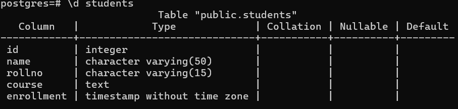
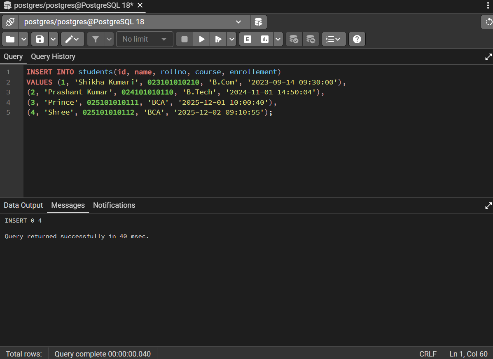
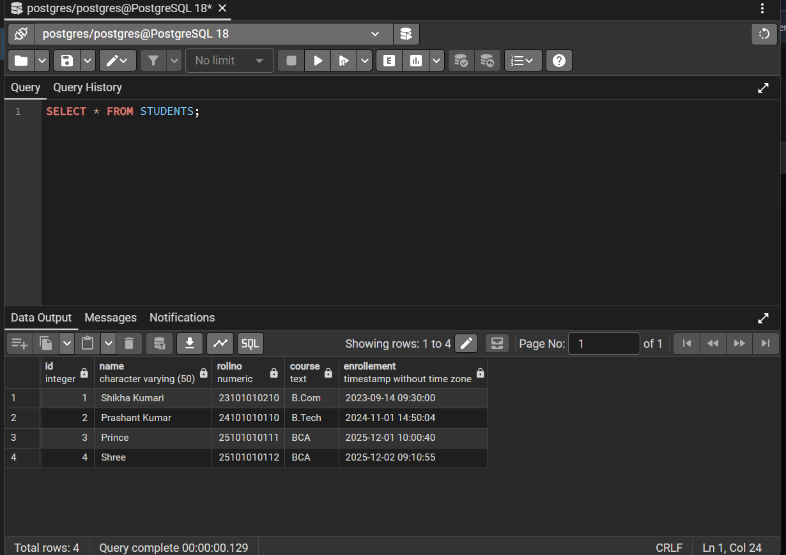
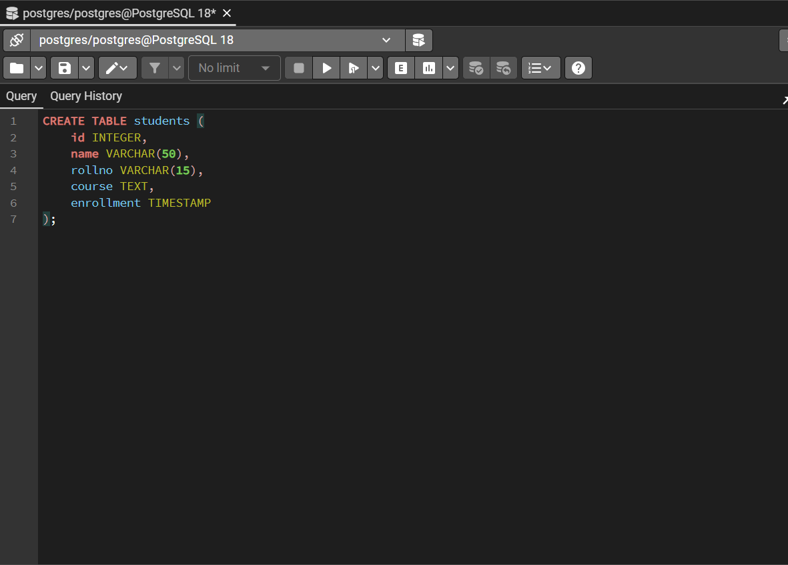
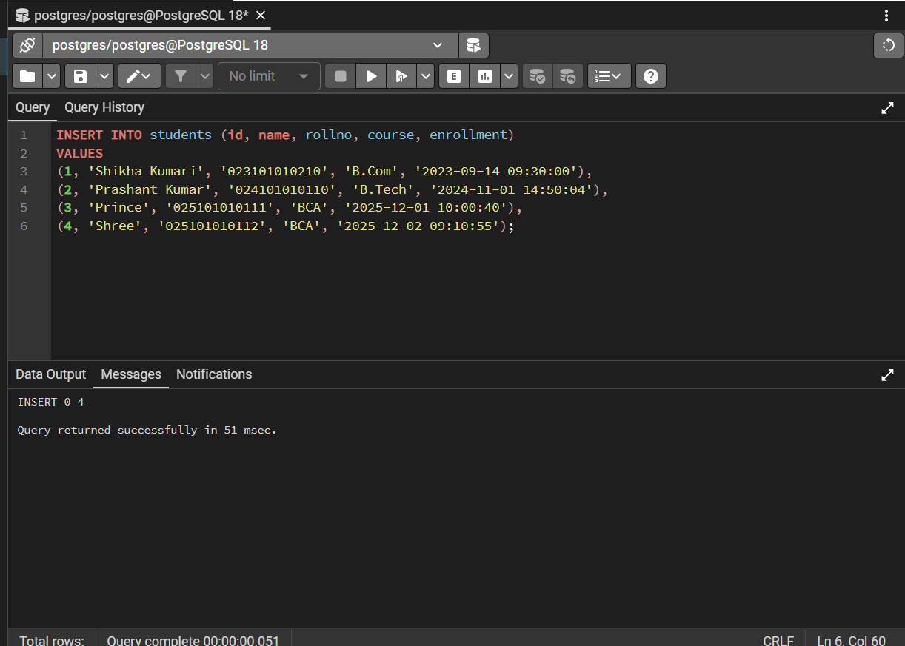
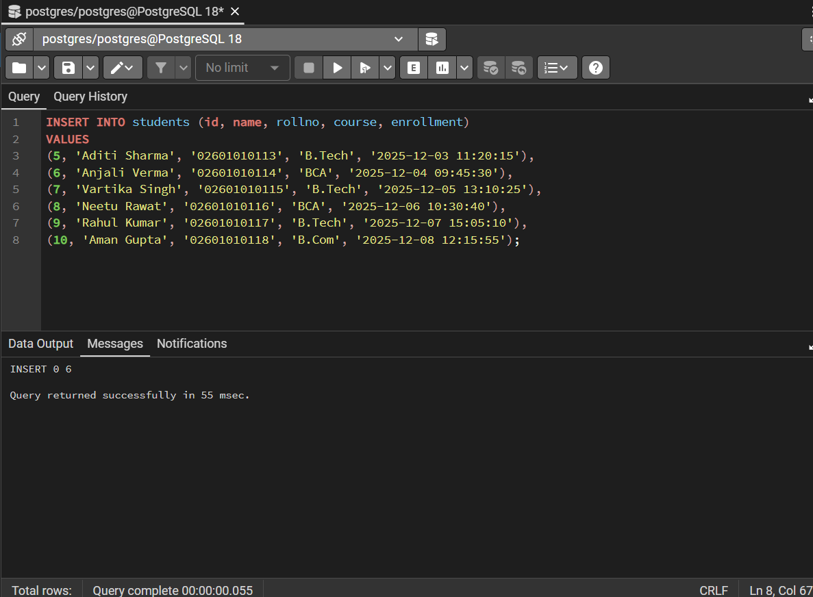
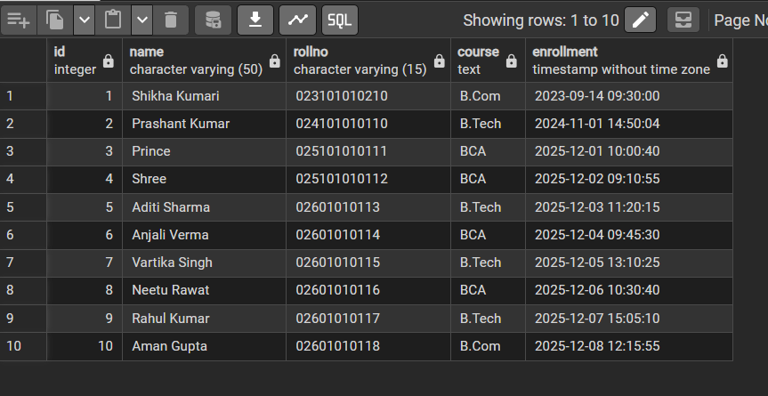

# Day 4: Basic INSERT and SELECT *

| Field | Value |
|---|---|
| Day | 4 |
| Date | 01-Nov-2026 |
| Phase | 1. Foundations |
| Type | Learn + Practice |
| Concept | Basic `INSERT` and `SELECT *` |
| Task | Insert 10 students; select everything and read the output |
| Status | Practical done; written review questions pending |
| Hours spent | 2 |
| Environment | Windows, PostgreSQL 18.6, psql 18.6, pgAdmin 4 (port 5433) |

---

## 1. Goal
Add rows to a table with `INSERT` and read them back with `SELECT *`.

## 2. Mental Model
A table is a spreadsheet with fixed columns.
- `INSERT` adds a new row at the bottom.
- `SELECT *` shows every column of every row.
- `SELECT` only reads. It never changes data.

## 3. Syntax

```sql
INSERT INTO table_name (column1, column2, column3)
VALUES (value1, value2, value3);

SELECT * FROM table_name;
```

Rules:
- The column list and the values must match in count and order.
- Text and timestamps go in single quotes: `'Aman'`.
- Double quotes mean a name (table or column), not a text value.
- A multi-row `INSERT` separates row groups with commas, and the last group has no comma.
- psql prints `INSERT 0 N` after an insert, where N is the number of rows added.

## 4. Table structure

Checked with `\d students` in psql.

| Column | Type |
|---|---|
| id | integer |
| name | character varying(50) |
| rollno | character varying(15) |
| course | text |
| enrollment | timestamp without time zone |

**Screenshot: `\d students` output**



## 5. What I ran

### 5.1 First attempt (and the bug)

`rollno` was originally `numeric`. I inserted `023101010210` but the table stored `23101010210`. The leading zero was lost.

**Screenshot: first INSERT (4 rows) with `rollno` as numeric**



**Screenshot: SELECT * showing the lost leading zeros**



### 5.2 Fix: recreate the table with the correct type

```sql
DROP TABLE students;

CREATE TABLE students (
    id         INTEGER,
    name       VARCHAR(50),
    rollno     VARCHAR(15),
    course     TEXT,
    enrollment TIMESTAMP
);
```

**Screenshot: CREATE TABLE**



### 5.3 Insert students 1 to 4

```sql
INSERT INTO students (id, name, rollno, course, enrollment)
VALUES
(1, 'Shikha Kumari', '023101010210', 'B.Com', '2023-09-14 09:30:00'),
(2, 'Prashant Kumar', '024101010110', 'B.Tech', '2024-11-01 14:50:04'),
(3, 'Prince', '025101010111', 'BCA', '2025-12-01 10:00:40'),
(4, 'Shree', '025101010112', 'BCA', '2025-12-02 09:10:55');
```

Result: `INSERT 0 4`

**Screenshot: INSERT (4 rows) with `rollno` as text**



### 5.4 Insert students 5 to 10

```sql
INSERT INTO students (id, name, rollno, course, enrollment)
VALUES
(5, 'Aditi Sharma', '02601010113', 'B.Tech', '2025-12-03 11:20:15'),
(6, 'Anjali Verma', '02601010114', 'BCA', '2025-12-04 09:45:30'),
(7, 'Vartika Singh', '02601010115', 'B.Tech', '2025-12-05 13:10:25'),
(8, 'Neetu Rawat', '02601010116', 'BCA', '2025-12-06 10:30:40'),
(9, 'Rahul Kumar', '02601010117', 'B.Tech', '2025-12-07 15:05:10'),
(10, 'Aman Gupta', '02601010118', 'B.Com', '2025-12-08 12:15:55');
```

Result: `INSERT 0 6`

**Screenshot: INSERT (6 rows)**



### 5.5 Read everything

```sql
SELECT * FROM students;
```

Result: 10 rows, with leading zeros preserved in `rollno`.

**Screenshot: SELECT * with all 10 rows**



## 6. Output I read

| id | name | rollno | course | enrollment |
|---|---|---|---|---|
| 1 | Shikha Kumari | 023101010210 | B.Com | 2023-09-14 09:30:00 |
| 2 | Prashant Kumar | 024101010110 | B.Tech | 2024-11-01 14:50:04 |
| 3 | Prince | 025101010111 | BCA | 2025-12-01 10:00:40 |
| 4 | Shree | 025101010112 | BCA | 2025-12-02 09:10:55 |
| 5 | Aditi Sharma | 02601010113 | B.Tech | 2025-12-03 11:20:15 |
| 6 | Anjali Verma | 02601010114 | BCA | 2025-12-04 09:45:30 |
| 7 | Vartika Singh | 02601010115 | B.Tech | 2025-12-05 13:10:25 |
| 8 | Neetu Rawat | 02601010116 | BCA | 2025-12-06 10:30:40 |
| 9 | Rahul Kumar | 02601010117 | B.Tech | 2025-12-07 15:05:10 |
| 10 | Aman Gupta | 02601010118 | B.Com | 2025-12-08 12:15:55 |

## 7. Key lessons

### 7.1 Identifiers are not numbers
`rollno` as `numeric` dropped the leading zero, because `023101010210` and `23101010210` are the same number. Ask: "Will I do arithmetic on this?" If not, store it as text.

Examples that should be text: roll numbers, phone numbers, PIN codes, Aadhaar numbers.

### 7.2 A successful INSERT does not mean correct data
Rows 1 to 4 have 12-character roll numbers. Rows 5 to 10 have 11 characters, so one digit is missing. `VARCHAR(15)` only limits the maximum length, so PostgreSQL accepted it. Validation rules (`CHECK` constraints) come later.

### 7.3 No primary key means duplicates are allowed
The table has no `PRIMARY KEY`, so nothing stops two rows with the same `id`. Constraints are the next topic.

### 7.4 SELECT * is for learning
`SELECT *` reads every row and every column. On a large production table this is slow. Real queries select specific columns and filter rows.

## 8. Common mistakes

| Mistake | Wrong | Right |
|---|---|---|
| Double quotes around text | `"Amit"` | `'Amit'` |
| Missing semicolon | `SELECT * FROM students` | `SELECT * FROM students;` |
| Column and value count mismatch | 5 columns, 4 values | counts must match |
| Missing quotes on text | `VALUES (1, Amit)` | `VALUES (1, 'Amit')` |
| Comma after the last row | `(..),(..),;` | no comma at the end |
| Number type for identifiers | `rollno numeric` | `rollno VARCHAR(15)` |

## 9. Under the hood
1. PostgreSQL parses the statement and checks the syntax.
2. It checks that the table and columns exist.
3. It checks the data types.
4. It checks constraints (none on this table yet).
5. It writes the change to the WAL (write-ahead log) first, then to the table.

`SELECT *` with no `WHERE` does a sequential scan, which reads every row.

## 10. Review Questions

### Reading the output

**1. Why are `id` values right-aligned while `name` values are left-aligned?**

- **My answer:** `id` is a numeric data type, so PostgreSQL displays it right-aligned. `name` is text, so it is displayed left-aligned.

**2. What does "timestamp without time zone" mean for the `enrollment` values?**

- **My answer:** It means the `enrollment` value stores the date and time, but it does not store or automatically adjust for any time zone.

**3. Is the row order guaranteed to match the insertion order? How could I guarantee it?**

- **My answer:** No. PostgreSQL does not guarantee row order unless I specify it. I can guarantee the order by using `ORDER BY`, for example `ORDER BY id`.

---

### Checkpoint

**4. Why was `numeric` the wrong type for `rollno`?**

- **My answer:** `rollno` is an identification number, not a number used for calculations. Using `numeric` can remove leading zeros, such as `023101010210`, so `VARCHAR` is more appropriate.

**5. On the old table, what would a search for `'023101010210'` have found?**

- **My answer:** If `rollno` was stored as a numeric value, the leading zero would have been lost. So searching for `'023101010210'` would not match the stored value `23101010210` as expected.

**6. Is `SELECT *` a read or a write operation?**

- **My answer:** `SELECT *` is a **read operation** because it only retrieves data from the table and does not change, insert, or delete any data.

## 12. Next step
Day 5: `SELECT` with specific columns, then `WHERE` filtering. After that, constraints (`PRIMARY KEY`, `NOT NULL`) to fix the problems found today.
