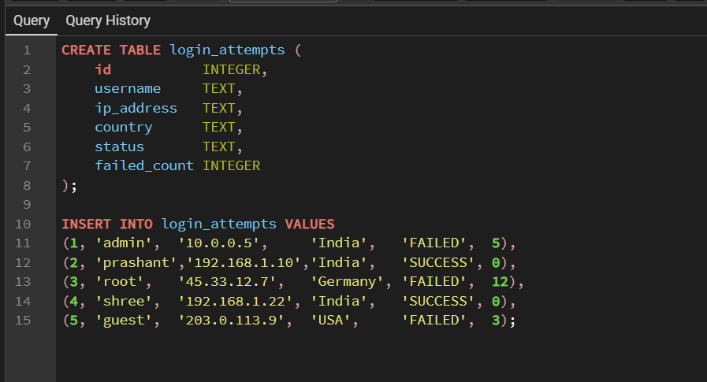
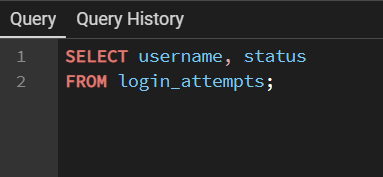
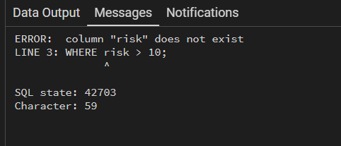
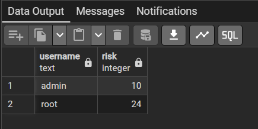
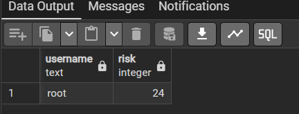
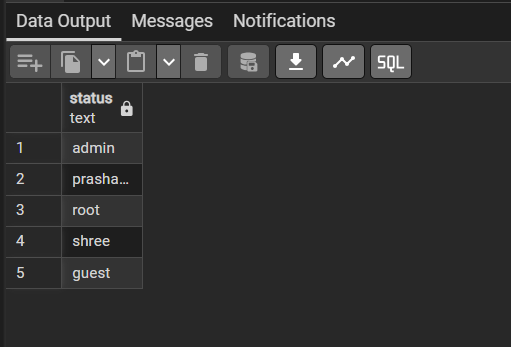
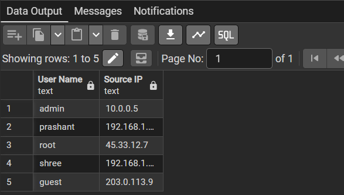

# Day 5: SELECT Specific Columns and Aliases (AS)

| Field | Value |
|---|---|
| Day | 5 |
| Date | 04-Nov-2026 |
| Phase | 1. Foundations (Week 1) |
| Type | Learn |
| Concept | SELECT specific columns; aliases with AS |
| Task | Write 5 queries that return different column combinations with aliases |
| Status | Completed |
| Hours spent | 2 |
| Environment | Windows, PostgreSQL 18.6, pgAdmin 4 (port 5433) |

---

## 1. Goal

- Select only the columns I need instead of `SELECT *`.
- Rename output columns with `AS`.
- Understand what an alias can and cannot do.
- Understand why aliases cannot normally be used in `WHERE`.
- Learn how PostgreSQL handles quoted and unquoted aliases.
- Practice selecting columns in different orders.

---

## 2. Practice Table

```sql
CREATE TABLE login_attempts (
    id           INTEGER,
    username     TEXT,
    ip_address   TEXT,
    country      TEXT,
    status       TEXT,
    failed_count INTEGER
);

INSERT INTO login_attempts VALUES
(1, 'admin',    '10.0.0.5',      'India',   'FAILED',  5),
(2, 'prashant', '192.168.1.10',  'India',   'SUCCESS', 0),
(3, 'root',     '45.33.12.7',    'Germany', 'FAILED',  12),
(4, 'shree',    '192.168.1.22',  'India',   'SUCCESS', 0),
(5, 'guest',    '203.0.113.9',   'USA',     'FAILED',  3);
```

**Screenshot: table created and rows inserted**



---

## 3. Core Concepts

### 3.1 Selecting Specific Columns

```sql
SELECT username, status
FROM login_attempts;
```

- Columns are separated by commas.
- There is no comma after the last column.
- The result shows columns in the order I write them, not the table's original order.
- `SELECT username, status` is more specific than `SELECT *`.

**Screenshot: output**



### 3.2 Aliases with AS

```sql
SELECT username AS user_name,
       ip_address AS source_ip
FROM login_attempts;
```

An alias changes the column name displayed in the query result. It **does not rename the actual column in the table**.

| Situation | Syntax | Note |
|---|---|---|
| Simple alias | `username AS uname` | No quotes needed |
| Spaces or capitals | `username AS "User Name"` | Double quotes required |
| Without `AS` | `username uname` | Legal, but avoid it |
| Single quotes | `username AS 'x'` | Syntax error in PostgreSQL |

### 3.3 Alias on an Expression

```sql
SELECT failed_count * 2 AS risk_score
FROM login_attempts;
```

The expression `failed_count * 2` creates a calculated column. Without an alias, PostgreSQL displays it as `?column?`. An alias makes the result easier to understand.

---

## 4. Under the Hood

A simplified logical order of query processing:

```text
FROM  ->  WHERE  ->  SELECT
```

The `WHERE` condition is evaluated before the `SELECT` alias is created, so PostgreSQL cannot normally use the alias inside `WHERE`. The alias is mainly an output label.

Note: `ORDER BY` runs after `SELECT`, so it **can** use aliases. I will practice this later.

---

## 5. Experiments I Ran

### 5.1 Alias Cannot Be Used in WHERE

```sql
SELECT failed_count * 2 AS risk
FROM login_attempts
WHERE risk > 10;
```

Result:

```text
ERROR:  column "risk" does not exist
LINE 2: FROM login_attempts WHERE risk > 10;
SQL state: 42703
```

`42703` is the standard error code for an undefined column. The caret (^) in the message points to the exact place where PostgreSQL got stuck.

**Screenshot: error**



#### Correct version

```sql
SELECT failed_count * 2 AS risk
FROM login_attempts
WHERE failed_count * 2 > 10;
```

Important distinction: `WHERE failed_count > 10` is **not equivalent** to `WHERE failed_count * 2 > 10`, because `failed_count * 2 > 10` means `failed_count > 5`. Changing the condition to `failed_count > 10` would silently change the meaning of the query. When an alias is not allowed, repeat the full expression.

#### A/B Comparison

**A**

```sql
SELECT username, failed_count * 2 AS risk
FROM login_attempts
WHERE failed_count * 2 > 8;
```

Condition: `failed_count > 4`

| username | failed_count | risk |
|---|---:|---:|
| admin | 5 | 10 |
| root | 12 | 24 |

**B**

```sql
SELECT username, failed_count * 2 AS risk
FROM login_attempts
WHERE failed_count > 8;
```

| username | failed_count | risk |
|---|---:|---:|
| root | 12 | 24 |

**Result:** A returns 2 rows (`admin`, `root`). B returns 1 row (`root`). Replacing the expression with the base column changed the meaning of the query.





### 5.2 Missing Comma Bug

```sql
SELECT username status
FROM login_attempts;
```

This does **not** select two columns. PostgreSQL reads it as `SELECT username AS status`. The result has one column named `status`, but the values are actually usernames, and there is no error.

**Screenshot: output**



Lesson: for two columns I must write `SELECT username, status`. A missing comma can silently change the meaning of a query instead of producing an error. Always write `AS` and count commas (number of columns minus 1).

### 5.3 Unquoted Aliases Are Folded to Lowercase

```sql
SELECT username AS uname,
       status AS Status,
       ip_address AS Source_ip,
       id AS Unique_No,
       country AS State
FROM login_attempts;
```

The headers shown were:

```text
uname | status | source_ip | unique_no | state
```

PostgreSQL folds unquoted identifiers to lowercase. To preserve capitals or spaces, use double quotes:

```sql
SELECT username AS "User Name",
       ip_address AS "Source IP"
FROM login_attempts;
```

**Screenshot: output**



Alias quality problems in that query:

- `status AS Status` renames nothing.
- `country AS State` is technically valid but misleading, because a country is not a state. An alias should make the result clearer and more accurate, never less.

---

## 6. Today's Task: 5 Queries

### Query 1: Many columns with simple aliases

```sql
SELECT username AS account_name,
       ip_address AS source_ip,
       status AS login_status,
       failed_count AS failed_attempts
FROM login_attempts;
```

The aliases describe the data more clearly than the original names.


### Query 2: Two columns with simple aliases

```sql
SELECT username AS user_name,
       country AS user_country
FROM login_attempts;
```


### Query 3: Different column order + quoted alias

```sql
SELECT status AS "Login Status",
       username AS "Account",
       country AS origin
FROM login_attempts;
```

This demonstrates a different column order than the table, a quoted alias with a space, and a normal unquoted alias.


### Query 4: Expression with an alias

```sql
SELECT username AS user_name,
       failed_count * 2 AS risk_score
FROM login_attempts;
```

For example: admin = 5 x 2 = 10, root = 12 x 2 = 24, guest = 3 x 2 = 6.


### Query 5: Report-style query

```sql
SELECT username AS account,
       status AS login_status,
       failed_count * 2 AS risk_score
FROM login_attempts;
```

This combines two base columns, one calculated expression, and aliases on every output column, which is closer to a real report or dashboard query.


---

## 7. Mini Challenge

### Working query

```sql
SELECT username AS "Account",
       country AS "Origin"
FROM login_attempts;
```

| Account | Origin |
|---|---|
| admin | India |
| prashant | India |
| root | Germany |
| shree | India |
| guest | USA |


### Break 1: Missing comma

```sql
SELECT username AS "Account"
       country AS "Origin"
FROM login_attempts;
```

Error: PostgreSQL reports a syntax error because there is no comma between the two selected expressions.

```text
ERROR:  syntax error at or near "country"
```


### Break 2: Invalid single-quoted alias

```sql
SELECT username AS 'Account',
       country AS 'Origin'
FROM login_attempts;
```

Error: single quotes are for string values, not for identifiers.

```text
ERROR:  syntax error at or near "'Account'"
```


Correct version: use double quotes (see the working query above).

---

## 8. Common Mistakes

1. Trailing comma before `FROM`: `SELECT username, status, FROM login_attempts;` is a syntax error.
2. Missing comma: `SELECT username status FROM login_attempts;` silently becomes an alias.
3. Single quotes around an alias: `AS 'Account'` is a syntax error.
4. Expecting an alias to rename the real table column. The actual column is still `username`.
5. Using an alias in `WHERE`: fails because `risk` is a `SELECT` alias.
6. Replacing an expression with the base column in `WHERE`: `failed_count > 10` is not the same as `failed_count * 2 > 10`.
7. Choosing a misleading alias: `country AS state` is bad, `country AS user_country` is better.
8. Forgetting that unquoted aliases are folded to lowercase: `AS UserName` becomes `username`.

---

## 9. Professional Note

`SELECT *` is useful when exploring a table, but explicit column selection is better in production:

- Less unnecessary data returned.
- Easier-to-read queries.
- More predictable output.
- Less risk when table structures change.
- Reduced chance of accidentally exposing sensitive columns such as password hashes.
- Supports data minimization, an important habit for cybersecurity work.

---

## 10. Recap

- `SELECT col1, col2` returns only the specified columns, in the order written.
- `AS` creates an alias for the output column only. It does not rename the table column.
- Double quotes allow spaces and preserve capitalization. Unquoted identifiers are folded to lowercase.
- Single quotes are string literals, not identifiers.
- Aliases are created in the `SELECT` step, so `WHERE` cannot use them. Repeat the full expression instead.
- An unnamed expression gets the header `?column?`.
- A missing comma can be read as an alias instead of causing an error. Always write `AS`.
- An alias must be at least as accurate as the original column name.

---

## 11. Checkpoint Answers

### 1. Difference between `AS "Total Count"` and `AS 'Total Count'`

`AS "Total Count"` uses double quotes for an identifier, so PostgreSQL accepts it as a column alias and preserves the space and capitalization. `AS 'Total Count'` uses single quotes, which PostgreSQL treats as a string literal, so it is a syntax error for a column alias.

### 2. Why is `SELECT username ip_address FROM login_attempts` dangerous?

PostgreSQL reads `ip_address` as an alias for `username`, so the query returns one column instead of two, without any error. The header says `ip_address` but the values are usernames. Using `AS` makes the intention clear. If I want both columns, I write `SELECT username, ip_address`.

### 3. Why does `WHERE risk > 10` fail when `risk` is an alias?

`risk` is created in the `SELECT` step, but `WHERE` is processed before `SELECT`. PostgreSQL therefore looks for a real column named `risk`, does not find one, and returns an undefined-column error. The fix is `WHERE failed_count * 2 > 10`.

### 4. One reason `SELECT *` is discouraged in production

`SELECT *` can return unnecessary or sensitive columns. If a password hash column is added to the table later, it is automatically included. Selecting only the required columns follows the principle of data minimization.

### 5. Row vs column

A **row** is one record in a table, for example `1 | admin | 10.0.0.5 | India | FAILED | 5`. A **column** is one attribute shared by all records, for example `username` or `country`.

### 6. When does PostgreSQL use `?column?` as a header?

When the `SELECT` list contains an expression with no alias, such as `SELECT failed_count * 2 FROM login_attempts;`. Adding `AS risk_score` gives the column a proper name.

---

## 12. Next Step

- Take Checkpoint 1 (05-Nov-2026), and revise Days 1 to 5 before it.
- Then continue with the next day in the 90-day plan.
